# RIH Care Insight Assistant

_A safety-first assistant that helps university students find campus health and support resources._

> **Independent student prototype.** This is not an official UMBC or Retriever Integrated
> Health (RIH) service. It shares information; it does not diagnose, counsel, treat or respond
> to emergencies. In an emergency call 911, or call or text 988. All conversations, accounts
> and test data in this repository are synthetic.

<p align="center">
  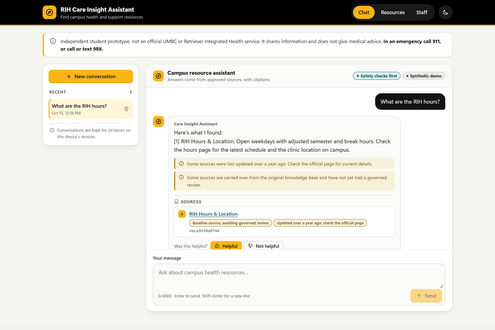
</p>

## Overview

Students often do not know which campus office handles their question, and a chatbot that
guesses can do real harm when the message is about a crisis, sexual misconduct or a threat. We
built this assistant to show how a helpful resource finder can be designed so that safety
never depends on a language model.

Our application checks every message with deterministic safety rules first. Crisis, Title IX
and conduct messages get fixed, reviewed guidance immediately. Everything else is answered only
from approved knowledge-base sources, with citations. When a student turns down a service, the
assistant offers other verified campus options instead of pushing. Staff reviewers have a
separate area to govern sources, risks and release decisions.

**Status (2026-10-15):** Phases 0–9 of our roadmap are implemented and validated on the branch
`feature/rih-local-enhancement-phases-2-9`. We record four authorizations separately:
- **Prototype acceptance:** given by both of us, for synthetic data only.
- **Public source code:** this repository.
- **Static showcase:** below.
- **Interactive deployment:** not authorized. The chatbot runs only on your own machine.

For interactive release, our readiness rules require both of us to decide on every risk, release
evidence for the exact code being released, and completed native-speaker, clinical, campus-source
and independent security reviews. None of those reviews has happened, so readiness is
**not ready** (see [Known limitations](#known-limitations)). Nothing here is production-ready.

**Static showcase:** <https://rih-care-insight-showcase.pages.dev/> is a page with reviewed
screenshots and diagrams that viewers cannot interact with. It has no chatbot or API, and the
application itself is not deployed.

## A tour of the interface

Every image below was captured automatically from the running application (FastAPI backend
and production frontend build, synthetic data, throwaway demo accounts) by our Playwright
script, `npm --prefix frontend run screenshots`. Nothing is mocked up.

### Student experience

| | |
|---|---|
| 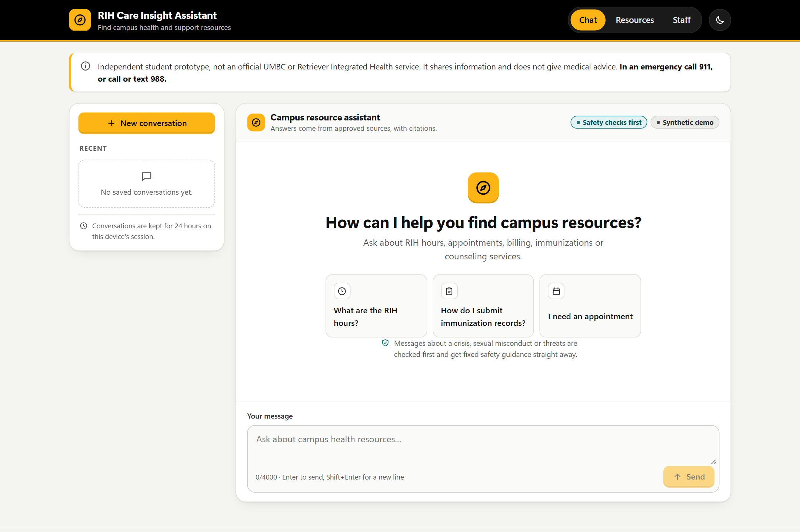 | 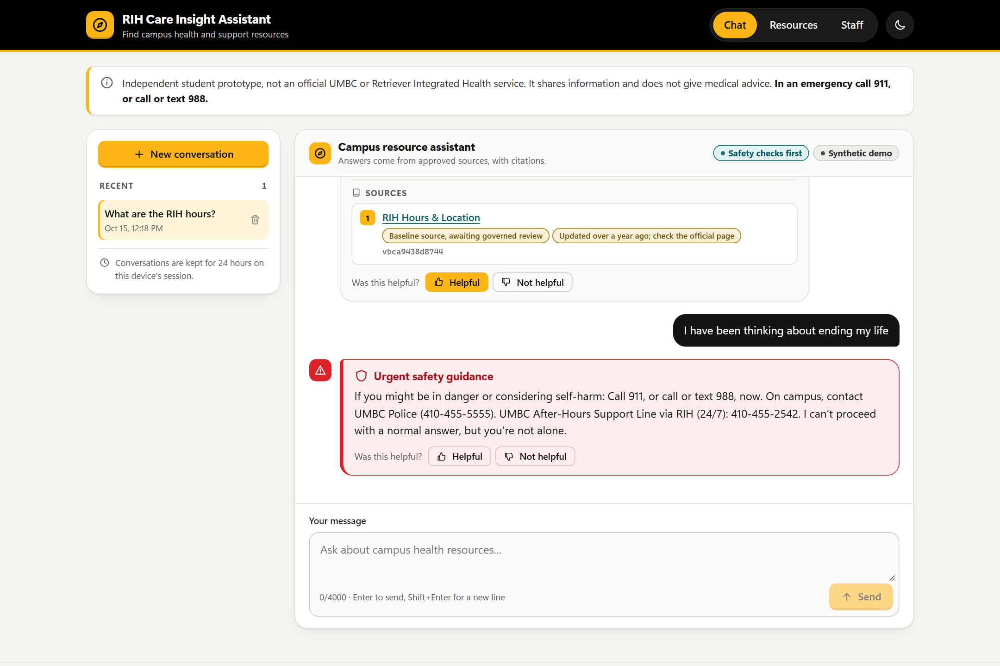 |
| **Welcome.** Example questions, the non-official disclaimer and emergency numbers are always visible. | **Safety first.** A crisis message gets fixed guidance in a distinct alert, with no sources and no model involved. |
| 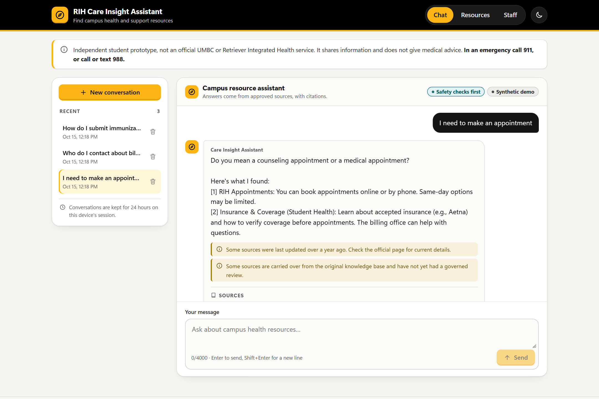 | 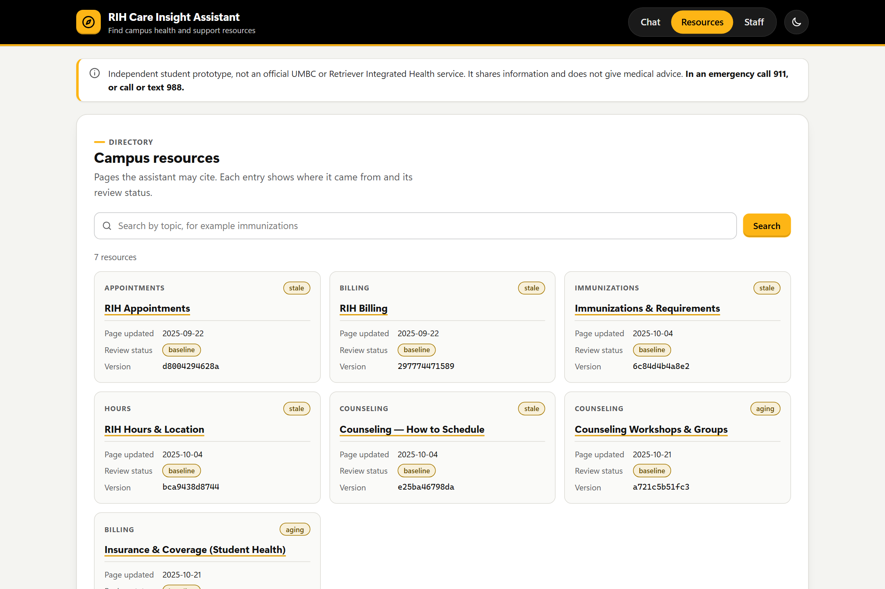 |
| **History and clarification.** Conversations are kept for 24 hours; ambiguous requests get server-defined options. | **Resource directory.** Every page the assistant may cite, with its review status, freshness and content version. |

<p align="center">
  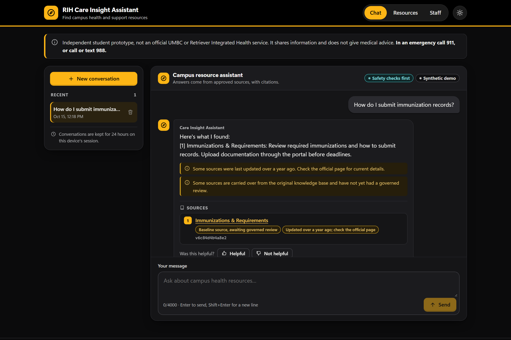
  &nbsp;
  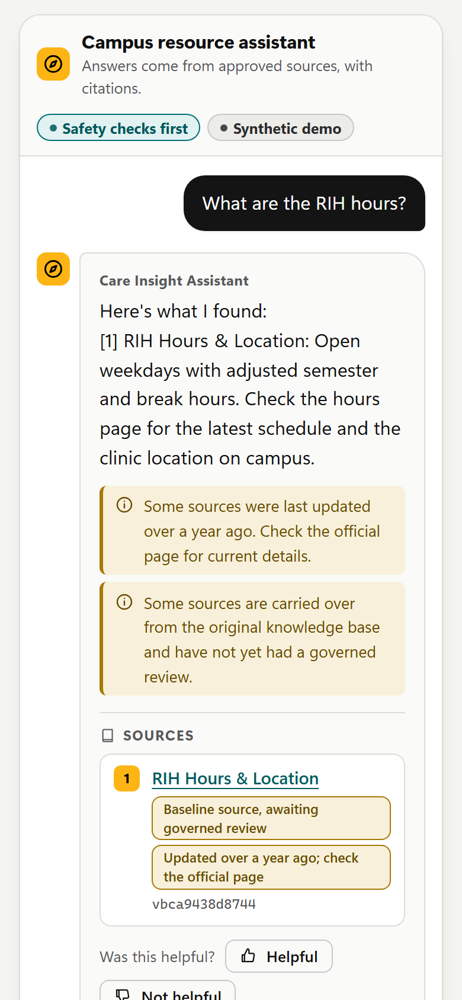
  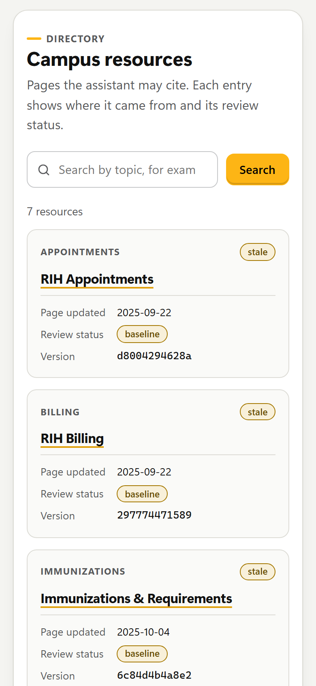
</p>
<p align="center"><em>Dark theme (follows the system setting, or the header toggle) and phone-sized layouts.</em></p>

### Staff, governance and observability

| | |
|---|---|
| 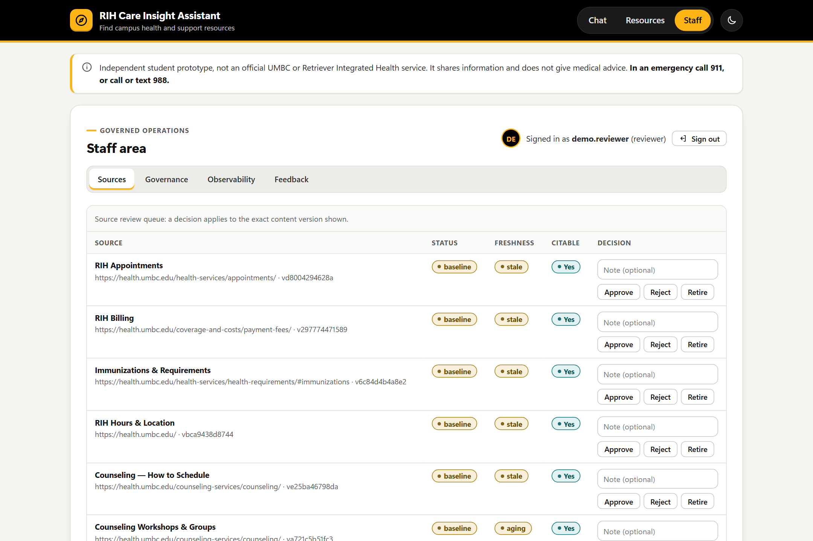 | 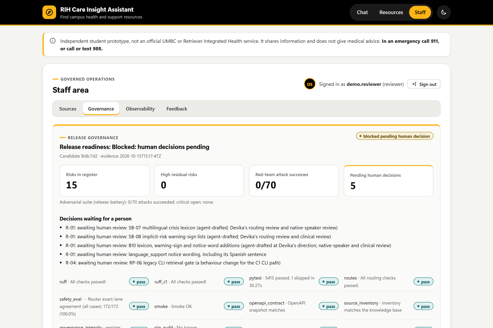 |
| **Source review.** Reviewers approve, reject or retire the exact content version shown. | **Governance.** Release readiness, red-team results and the decisions still waiting for a person. |
| 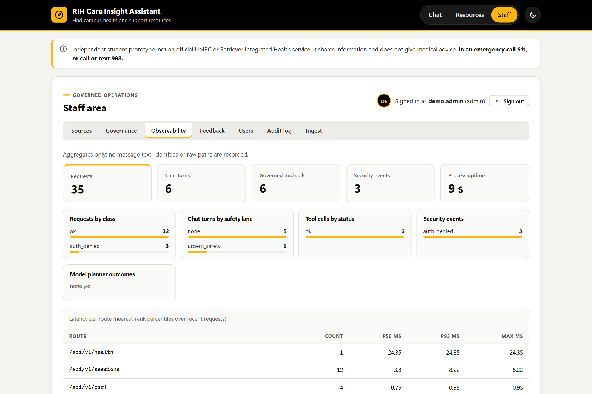 | 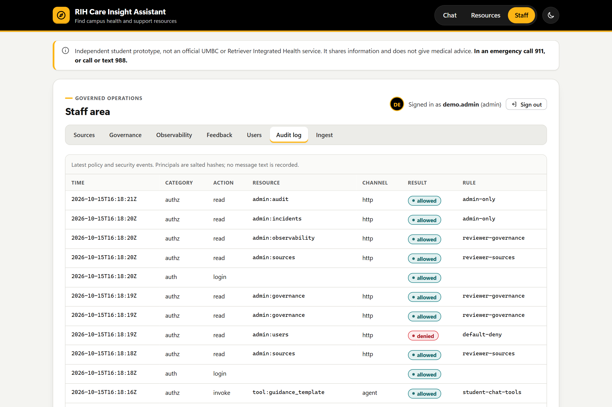 |
| **Observability.** Aggregate traffic, safety lanes, tool calls, security events and latency, with no message text. | **Audit log.** Every policy decision, including the denied request a reviewer made for admin-only data. |

The risk register ([image](docs/assets/screenshots/governance-risk-register.png)) and the
server-gated staff sign-in ([image](docs/assets/screenshots/staff-signin.png)) are captured too.
The governance screenshots were taken before the joint-decision rules (L-D13). The current
screen shows each joint reviewer's own decision, the specialist reviews and the release scope.
We kept the reviewed images rather than replacing them.

### Design system

We designed a black-and-gold visual identity inspired by the UMBC palette (gold `#FDB515`,
black and white, with dark gray, light gray, AOK teal, red and Retriever brown as accents). All
colors are CSS design tokens in [`frontend/src/styles.css`](frontend/src/styles.css), with a
light and a dark theme. Gold buttons always carry black text, red is reserved for warnings and
safety alerts, and teal marks approved or passing states. A unit test
([`theme.test.ts`](frontend/src/theme.test.ts)) checks every text and control pairing against
WCAG AA contrast in both themes. Every control shows a visible focus ring, and the layout works
from phone width up. The project uses no university logos and is not endorsed by UMBC.

## Main features

- **Deterministic safety routing.** Crisis, Title IX and conduct detection runs before any
  planner, retrieval or model, resists common obfuscation, and cannot be lowered by model
  output. Safety replies still go out if storage, retrieval or policy checks fail.
- **Grounded answers with citations.** Retrieval uses only inventoried, approved, unexpired
  sources whose content hash matches; citations are checked against the evidence used in that
  turn.
- **Decline handling and clarification.** Respectful alternatives when a student says no to a
  service, and a short clarifying question when a request is ambiguous.
- **Governed tools and an optional local model.** Every tool call is validated, authorized,
  budgeted and time-limited. A small local model (via Ollama) can propose tool calls, but it
  never writes answer text and never sees safety messages. Model features are off by default.
- **Staff area.** Password login with lockout, role-based access defined as policy files
  (default deny), source review, risk register, release decisions and an observability view.
- **Operational hardening.** Non-root, read-only containers, a local Kubernetes deployment with
  default-deny network policies, OpenTelemetry traces and metrics with privacy allowlists, and a
  release battery that produces a readiness verdict.

## Architecture

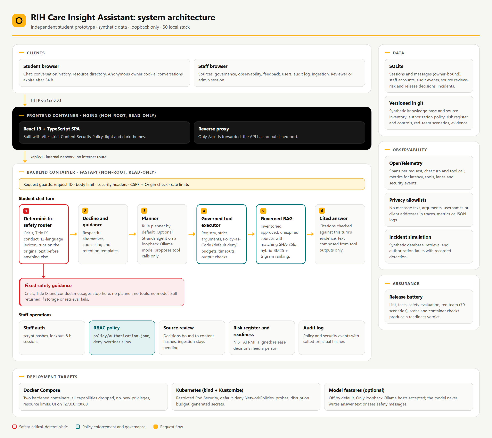

**How a request flows.** The browser talks only to the nginx container, which serves the React
app and forwards `/api` to the backend on an internal network with no internet route. In the
backend, request guards (CSRF and Origin checks, rate and size limits) run first. A chat
message then goes to the **deterministic safety router** before anything else: crisis, Title IX
and conduct messages get fixed guidance and the turn ends there. Other messages go through
decline handling, then a planner (rules by default, or an optional local model that can only
propose tool calls). Every tool call passes the **governed executor** (strict arguments,
Policy-as-Code authorization with default deny, budgets, timeouts), and retrieval uses only
approved, unexpired, hash-matched sources. The answer is composed from tool outputs, and its
citations are checked against the evidence used in that turn. Staff requests take a separate
path: password login, role-based policy, then review, governance and audit features. Traces,
metrics and logs record status and policy rules, never message text.

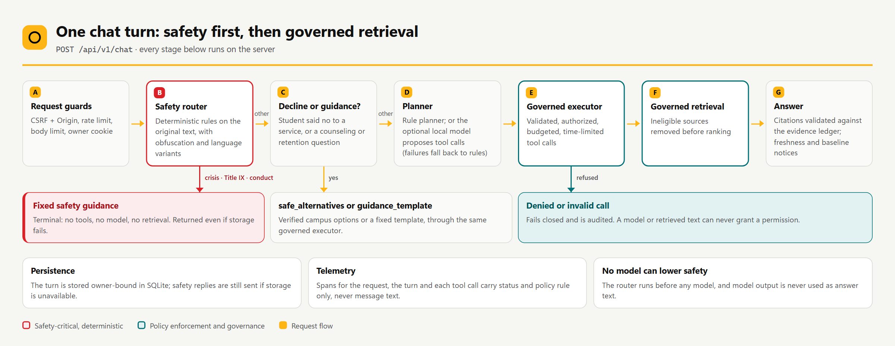

The diagrams are rendered from editable HTML sources in
[`docs/architecture/diagrams/`](docs/architecture/diagrams/) by the same Playwright script.
Text versions (Mermaid) of the deployment, request path, retrieval and authorization views are
in [`docs/architecture/system-overview.md`](docs/architecture/system-overview.md).

## Technology stack

| Layer | Tools |
|---|---|
| Backend | Python 3.11–3.14, FastAPI, Pydantic, Uvicorn, SQLite |
| Frontend | React 19, TypeScript, Vite, Vitest, Playwright |
| Agents (optional) | Strands Agents with a loopback-only Ollama model |
| Security and governance | Policy-as-Code JSON (RBAC), scrypt password hashing, Bandit, pip-audit, npm audit, Trivy, gitleaks |
| Observability | OpenTelemetry API and SDK, structured JSON logs |
| Deployment | Docker Compose, kind, Kustomize, nginx |
| Quality | pytest, Ruff, ESLint, GitHub Actions workflow |

## Repository structure

```text
app/            Python application
  router/       deterministic safety routing (crisis, Title IX, conduct, languages)
  agent/        dispatcher (CLI), orchestrator (API), planners, governed toolkit
  rag/          governed retrieval: inventory, eligibility, ranking, citations, ingestion
  api/          FastAPI app, routes, schemas, database, migrations
  security/     policy engine, passwords, rate limiting
  governance/   risk register checks and release readiness
  observability/ telemetry and incident simulation
  ui/           original command-line interface
frontend/       React + TypeScript UI, component tests (src/), end-to-end tests (e2e/),
                screenshot and diagram automation (screenshots/)
tests/          pytest suites (safety, API, RAG, security, governance, C1 regression)
scripts/        evaluation, red team, release battery, container and Kubernetes checks
deploy/         Dockerfiles, nginx config, Kubernetes manifests, kind cluster config
safety/         routing matrix and safety copy guidelines
kb/             synthetic knowledge base and source governance files
policy/         authorization policy (roles and permissions)
governance/     risk register and controls
security/       versioned red-team scenarios
contracts/      OpenAPI snapshot of the API
docs/           architecture, safety, security, deployment, evidence and project records
  assets/       screenshots and rendered architecture diagrams used in this README
compose.yaml    local Docker Compose stack
```

## Local setup

Requirements: Python 3.11 or newer (we validated 3.13 and 3.14) and Node.js 22 or newer
(we used Node 24). No accounts, API keys or paid services are needed.

```bash
git clone https://github.com/RIH-Care-Insight-Assistant/RIH-Assistant.git
cd RIH-Assistant
python3 -m venv .venv
. .venv/bin/activate                      # Windows PowerShell: .venv\Scripts\Activate.ps1
python -m pip install -r requirements.txt -r requirements-dev.txt
npm --prefix frontend ci
```

## Using the application

Start the API (model features off, loopback HTTP cookies allowed):

```bash
export STRANDS_ENABLED=false RIH_PLANNER=RULE RIH_COOKIE_SECURE=false
uvicorn app.api.main:app --host 127.0.0.1 --port 8000
```

In a second terminal, start the frontend and open <http://127.0.0.1:5173>:

```bash
npm --prefix frontend run dev
```

Create a staff account for the staff area (the password is prompted for, never echoed):

```bash
python scripts/manage_users.py create --username your.name --role admin
```

The original command-line interface still works without the API:

```bash
python -m app.ui.cli
```

To try the optional planner, run [Ollama](https://ollama.com) locally with a small model such
as `qwen2.5:1.5b`, then set `STRANDS_ENABLED=true RIH_PLANNER=LLM RIH_OLLAMA_MODEL=qwen2.5:1.5b`.
Only loopback model hosts are accepted. A guided tour of the student, staff and governance
flows is in [`docs/demo-walkthrough.md`](docs/demo-walkthrough.md).

## Docker deployment

```bash
docker compose up -d --build
docker compose exec backend python scripts/manage_users.py create --username your.name --role admin
```

Open <http://127.0.0.1:8080>. The backend has no published port and no internet route; only
the frontend proxy is exposed, on loopback. Stop with `docker compose down`, or reset all demo
data with `docker compose down -v`. The demo uses loopback HTTP with `RIH_COOKIE_SECURE=false`;
any other setup needs HTTPS and `RIH_COOKIE_SECURE=true`.

## Kubernetes deployment

We deploy to a local [kind](https://kind.sigs.k8s.io/) cluster with Kustomize. This needs
Docker, `kubectl` and kind.

```bash
docker compose build
python scripts/k8s.py up        # cluster "rih"; UI on http://127.0.0.1:8090
python scripts/k8s.py verify    # workflows, security contexts, network policies, red team
python scripts/k8s.py down
```

The manifests use a restricted Pod Security namespace, probes, resource limits, generated
secrets, a disruption budget and default-deny network policies. Rollout, rollback and recovery
procedures are in [`docs/deployment/kubernetes.md`](docs/deployment/kubernetes.md).

## Testing and security evaluation

Automated tests never need a model provider or network access.

```bash
export STRANDS_ENABLED=false RIH_PLANNER=RULE
ruff check .
python -m pytest -q
python scripts/check_routes.py
python scripts/safety_eval.py --fail-on-miss
npm --prefix frontend run lint && npm --prefix frontend run typecheck && npm --prefix frontend test
npm --prefix frontend run e2e                 # Playwright against the real API
python scripts/redteam.py                     # adversarial suite
python scripts/release_readiness.py --e2e     # full battery and readiness verdict
npm --prefix frontend run screenshots         # regenerate README screenshots and diagrams
```

`npm run screenshots` starts its own throwaway backend and a production frontend build on
loopback ports, so it needs the Python environment from [Local setup](#local-setup) (set
`RIH_PYTHON` to the venv's Python if `python` is not on your path).

The complete list of release gates is in [`docs/RELEASE_GATES.md`](docs/RELEASE_GATES.md).
Recorded results from our final validation (2026-10-15, release candidate `c22b360`, Windows 11
and WSL2 Ubuntu; raw evidence in [`docs/evidence/`](docs/evidence/)):

| Check | Result |
|---|---|
| Release battery (with containers) | 21 of 21 gates passed on the candidate (5494 tests passed, 1 skipped on Windows; 5495 passed on WSL2). Two earlier runs failed and are kept: they found a dependency advisory and a static-analysis issue, both fixed |
| Safety routing regression set | 172 of 172 routed as expected, no false positives on benign cases |
| Independent held-out set (Devika, 208 cases, frozen before review) | 149 of 208 on the first, unfixed run; 0 of 82 benign or ambiguous messages escalated. The gaps found were then fixed, so later runs are no longer held out |
| Red team (70 versioned scenarios) | 5 of 70 attacks succeeded initially; 0 of 70 after mitigation, 0 of 35 over HTTP in Compose and kind |
| Containers | integration 7/7, resilience 7/7, image and config scans clean |
| Kubernetes | verify 7/7, rollout and rollback 5/5 with no failed requests, recovery 4/4 |
| Release gate negative check | 3 of 3 deliberate critical regressions blocked |
| Server log privacy probe | no message text, ids, tokens or credentials in server output |

The safety regression set was written alongside the rules, so its score is optimistic; the
held-out first run is the more realistic estimate. Write-ups:
[security evaluation](docs/security/security-evaluation.md),
[red-team report](docs/security/redteam-report.md),
[threat model](docs/THREAT_MODEL.md),
[crisis routing](docs/safety/crisis-routing.md).

## Known limitations

- Safety routing is pattern-based. It still misses crisis wording in languages outside its
  12-language list and implicit risk phrased in ways it has not seen. The non-English and
  implicit-risk terms have not been reviewed by native speakers or clinicians.
- Knowledge-base content is a small synthetic set carried over from our first version and not
  yet re-reviewed under the governed process, so answers show baseline and staleness notices.
- One API replica, SQLite storage, local HTTP only, and password login without MFA.
- The GitHub Actions jobs for the newer gates have not run on GitHub yet.
- No independent security assessment has been done. The red-team scenarios were written in our
  own sessions.
- Interactive release stays blocked until both of us decide on every risk in the staff interface,
  and the native-speaker, clinical, campus-source and independent security reviews are completed
  (see [`docs/FINAL_REPORT.md`](docs/FINAL_REPORT.md)).
- On the Office of Equity and Civil Rights page, the phone links dial different numbers from the
  ones displayed. Our templates use the displayed numbers; the office has not yet confirmed which
  number is correct ([crisis routing §6](docs/safety/crisis-routing.md)).

The full list is in [`docs/limitations.md`](docs/limitations.md).

## Contributors

- **Abhinav Varma Vathadi**
- **Devika Rani Sanaboyina**

We built the first version together and completed checkpoint C1 through reviewed pull requests.
Abhinav led the safety router, dispatcher, CI and the Phase 2–9 enhancement. Devika led the
knowledge-base audit, retrieval restrictions, decline handling and campus alternatives, the
threat model and contract drafts, the held-out safety evaluations and the final safety and
security review. We used AI coding assistants under our direction during development; the
project records in [`docs/`](docs/) state which work was agent-drafted and what each of us
reviewed.

UMBC, MPS Data Science. Licensed under the terms in [`LICENSE`](LICENSE).
