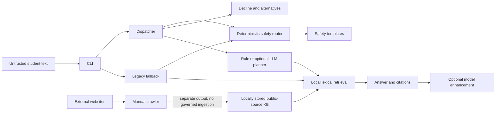

# C1 initial threat model — draft for joint review

Scope: the CLI application at `b05da1500928fc1725669878e78440fb04663f6a` and
Devika's additive audit/tests. This independent student-resource prototype must
not be presented as an officially authorized UMBC healthcare service. Only public
sources and synthetic conversations are used. This is an engineering assessment,
not a claim of certification or deployment readiness.

## Architecture and trust boundaries

The diagram represents components, not proof of enforced precedence. Dispatcher
currently checks crisis first, then decline before other policy templates. The
legacy fallback skips decline and has distinct behavior. The crawler writes a
separate data file; no reviewed ingestion pipeline connects it to the KB.

Assets: crisis/policy guidance integrity; citation and resource accuracy; student
privacy; future session and role isolation; source and repository integrity; model
credentials; trustworthy evaluation evidence and contributor attribution.

Untrusted boundaries: input entering router/planner; source content entering the
KB; model output selecting tools/rewriting answers; frontend-to-backend in future
C2; logs and artifacts leaving process memory. Local JSONL is data, not executable
instructions or proof of source approval. Hostname validation does not authenticate
text, validate redirects, or authorize a tool call.

## Findings and proposed controls

Severity below is provisional engineering prioritization, pending joint review.

| ID | Threat / observed condition | Priority | Current evidence / next owner |
| --- | --- | --- | --- |
| C1-R01 | Decline overrides non-crisis policy lanes, including Title IX and retention | High | Reproduced trace in audit; proposed C1-v0.2: Abhinav owns dispatcher precedence for Title IX, conduct and retention; Devika cross-tests; joint approval pending |
| C1-R02 | Retrieval ignores `allow_chat: false` and `page_type: crisis` | High | `retrieve('urgent')` returns Crisis Support with allow_chat false; proposed C1-v0.2: Devika owns filtering before ranking/returning ordinary chat results; preserve public retrieve() API; joint approval pending |
| C1-R03 | Negation and broad matching misclassify requests as refusals | Medium | Three reproduced false positives and curly-apostrophe false negative; Devika repairs after behavioral agreement |
| C1-R04 | KB and alternatives lack approval/freshness enforcement | High | Nine aged records; alternatives have no source links; Devika audits, proposes evidence-backed copy; Phase 3 governs sources |
| C1-R05 | Invalid JSON values can crash retrieval despite malformed-line handling | Medium | Loader accepts non-dictionaries/non-string fields; audit utility flags types; repair ownership pending |
| C1-R06 | Optional model changes facts or tool arguments beyond prompt expectations | High | Prompts/token checks and tool whitelist exist, but are not full semantic validation or backend authorization; Abhinav reviews orchestration; governed contracts later |
| C1-R07 | Timeout does not guarantee cancellation | Medium | ThreadPoolExecutor context manager waits on worker shutdown; not a demonstrated bounded hard timeout; Abhinav review, resilience in C5 |
| C1-R08 | Crawler redirect/SSRF boundary is incomplete | High before ingestion exposure | Initial hostname allowlist precedes requests' redirects; no redirect-hop/DNS/private-network policy; not executed or exposed in this slice |
| C1-R09 | Logs, debug trace, and exceptions can disclose input or planner content | Medium | Planner trace can contain query/steps and exception text; no raw student data in new audit artifacts; privacy telemetry design required before full stack |
| C1-R10 | Main protection and dependency reproducibility not established | High before release | No rulesets; protection API denied; unpinned runtime dependencies and no workflow in checkout; Abhinav CI and human settings review |

Existing mitigations verified locally: original-input deterministic crisis early
return, optional model disabled by default, offline fallback, legacy CLI retained,
and regression checks that crisis returns before lower-priority components. These
do not establish safety recall over unknown wording or validate all clinical copy.

The pending C1-v0.2 contract keeps deterministic crisis responses separate from
ordinary chat retrieval: restricting the eligible KB corpus must not make crisis
guidance unavailable. Devika owns proposed decline semantics, verified alternatives,
retrieval restrictions and corresponding cross-tests; Abhinav owns dispatcher-level
precedence. These are proposed repair boundaries, not implemented mitigations.
Neither contributor may change shared interfaces or dependencies unilaterally.

## Later-phase requirements

C2 must approve session/auth/database/API boundaries before implementing them.
C3 must enforce default-deny authorization in one backend policy engine before
every tool action; browser prompts and model instructions are not permissions.
Future ingestion must reject unsafe URLs/redirects and treat poisoned content as
untrusted data. Future React rendering must avoid HTML execution. Session, RBAC,
CSRF, rate-limit, and admin exposure controls remain unimplemented, not passed.

Each accepted risk needs human owner, control, executable test, evidence reference,
and residual-risk decision in later governance. No real health data, billable
provider calls, cloud deployment, or live attack activity was used for this audit.

## Phase 2–4 update (local-first, 2026-10-15)

Appended under the local-first workflow; the C1 analysis above is unchanged. Status
values describe what is implemented and tested locally, not production assurance.

| Risk | Control now in place | Executable evidence | Residual |
|---|---|---|---|
| C1-R06 model changes tool use | Governed executor: registry, strict arguments, Policy-as-Code (default deny, agent channel cannot reach `admin:*`), budgets, output validation; model prose discarded | `tests/agent/`, `tests/security/test_prompt_injection_misuse.py`, `tests/security/test_policy_engine.py` | Model choice quality (the local 1.5B model often skips tools; rule fallback covers it) |
| C1-R07 timeout without cancellation | Planner slot is held until the model call truly ends; circuit breaker; at most 2 in-flight model calls; late tool calls after a timeout are refused | `tests/agent/test_strands_planner.py` | Python cannot kill a hung thread; bounded, not eliminated |
| C1-R08 crawler SSRF | `app/rag/ingest.py`: HTTPS allowlist, public-address check for every resolved IP, per-hop redirect validation, peer-address pinning check, size/type/time bounds; admin-only. The unguarded C1 crawler (`scripts/crawl_site.py`) was removed in the repository cleanup | `tests/security/test_ingest_ssrf.py` | DNS rebinding detection depends on the HTTP stack exposing the peer address |
| C1-R09 disclosure in logs/errors | Error envelope with fixed copy; tool events and audit rows carry no arguments or message text; principals hashed with a server salt | `tests/api/test_api_sessions.py`, `tests/api/test_auth_admin.py::test_audit_log_records_decisions_without_identities_or_text` | Structured application logging is Phase 7 |
| Cross-session access | Every query binds server-derived owner and session; foreign sessions return the same 404 as missing ones | `tests/api/test_api_sessions.py::test_foreign_session_is_indistinguishable_from_missing` | Anonymous credential is per browser; no account recovery by design |
| CSRF / XSS | Double-submit token + Origin allowlist on every mutation; CSP and `nosniff` on API responses; React renders text only (ESLint rule bans `dangerouslySetInnerHTML`); only HTTPS citation links | API and component tests | Frontend CSP for the static server is configured in Phase 8 |
| Staff account abuse | scrypt hashes, lockout, rate limits, idle/absolute session expiry, hardened cookies, role checks server-side | `tests/api/test_auth_admin.py` | No MFA (local prototype) |
| Poisoned or unreviewed content | Inventory + approval + hash binding + freshness + quarantine; eligibility before ranking | `tests/rag/test_governance.py`, `tests/api/test_governed_api.py` | Pattern-based detector can miss paraphrased instructions |
| Vulnerable dependencies | Pinned versions; `pip-audit` and `npm audit` clean on 2026-10-15; Bandit no medium/high | Recorded in `LOCAL_FIRST_PROGRESS.md` | New advisories appear over time; rerun before publication |

Phase 5 measures these controls adversarially with versioned fixtures.
