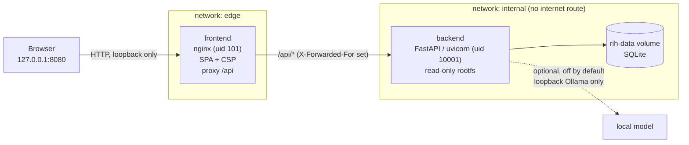
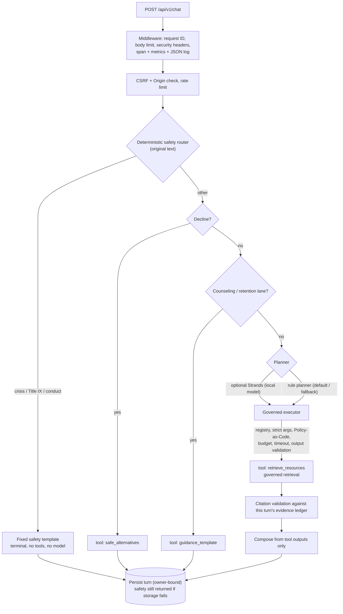
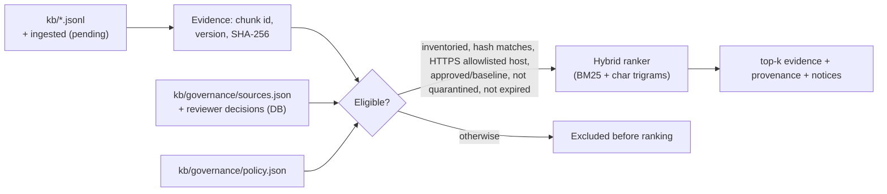
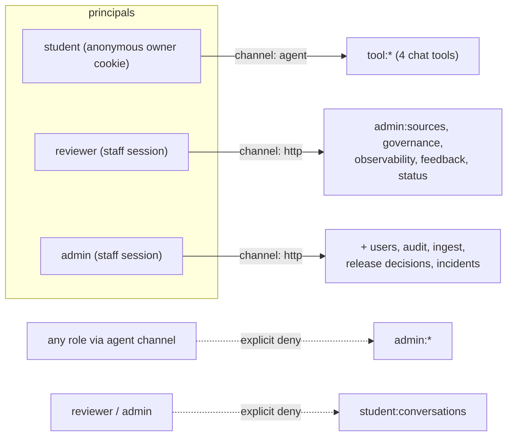

# System overview

Detailed notes: [`agents-and-rag.md`](agents-and-rag.md) (Phase 3),
[`observability.md`](observability.md) (Phase 7), [`python-application.md`](python-application.md)
(C1 Python core), contracts in [`../INTERFACE_CONTRACTS.md`](../INTERFACE_CONTRACTS.md).

Rendered overviews (sources in [`diagrams/`](diagrams/), regenerated with
`npm --prefix frontend run screenshots`): [system architecture](../assets/architecture/system-architecture.png)
and [one chat turn](../assets/architecture/request-flow.png). The Mermaid views below are the
text versions.

## Deployment (Docker Compose, Phase 8)

Both containers drop all capabilities, run read-only with `no-new-privileges`, and have memory,
CPU and process limits. The API has no published port and no internet route.

## Request path for a chat turn

## Governed retrieval

## Authorization

Policy file: [`../../policy/authorization.json`](../../policy/authorization.json); engine:
`app/security/policy_engine.py` (default deny, deny overrides allow).

## Data

| Store | Contents | Retention |
|---|---|---|
| SQLite `owners`, `sessions`, `messages`, `feedback` | Synthetic demo conversations, owner-bound | Owners expire after 24 h; purged at startup |
| `users`, `staff_sessions` | Staff accounts (scrypt hashes), session token hashes | Sessions 8 h absolute, 30 min idle |
| `audit_events` | Policy and security decisions with salted principal hashes | Local only |
| `source_reviews`, `ingested_sources` | Reviewer decisions bound to content hashes; ingested pages (pending) | Local only |
| `risk_reviews`, `release_decisions`, `incidents` | Human governance records; synthetic incident simulations | Local only |
| Files in git | KB, source inventory and policy, authorization policy, risk register, control catalog, red-team fixtures, evidence | Versioned |
